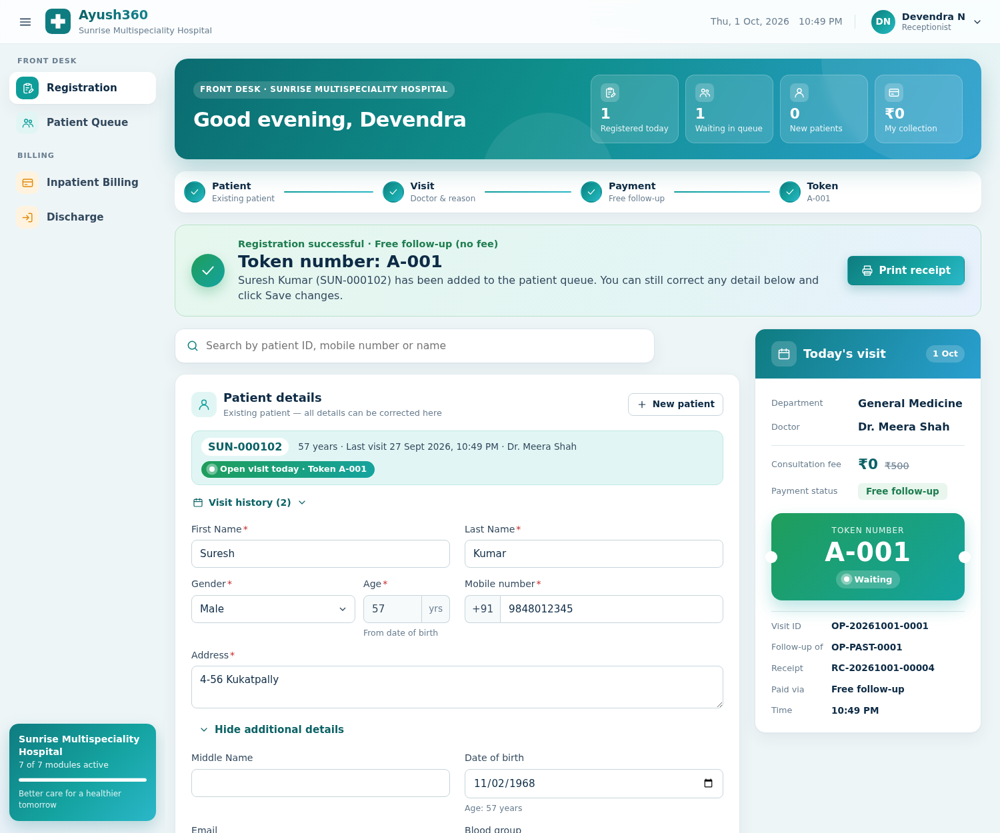

# Ayush360 – HMS Frontend

React + TypeScript + Vite frontend for the Ayush360 Hospital Management System.
Iteration 1 delivers the **Front Desk → Patient Registration** screen. It follows
*Healthcare SaaS Platform – Architecture & Registration Module Discussion* and the
*Registration and Reception Workflow Guide* (Figure 1).

For the project overview (decisions, modules, roadmap, users, API contract and change log), see **[docs/PROJECT-OVERVIEW.md](docs/PROJECT-OVERVIEW.md)**.



## Getting started

```bash
npm install
cp .env.example .env.local   # optional; mock API is on by default
npm run dev                  # http://localhost:5173
```

The mock API is on by default (`VITE_USE_MOCK_API=true`). Sign in with one of these demo accounts (password `demo123`):

| Username | Role | Hospital (tenant) |
|---|---|---|
| `dev` | Receptionist | Swetha Multispeciality Hospital (10) |
| `hari` | Receptionist | Green Valley Hospital (20). Has bought Front Desk and Doctor only |
| `priya` | Admin | Swetha (10). Sees every module |
| `sriya` | Doctor | Swetha (10). Can't open Registration |

Seeded patients to try in the search: `9876543210`, `SUN-000102` and `Ananya`. Each hospital only sees its own patients.
Suresh Kumar (`9848012345`) saw Dr. Meera Shah 4 days ago, so a new visit to her at Swetha is a **free follow-up** (10-day window).
To simulate a declined payment, choose UPI or Card and enter `0000` as the reference.
To reset the mock data, run `resetMockDb()` in the browser console.

Scripts: `npm run dev`, `npm run build`, `npm run typecheck`, `npm run check:boundaries`, `npm run preview`.

## Sellable modules

The app is one React application made of product modules. Each module can be sold on its own. A hospital sees a module only when the module is in its licence (`core.tenant_modules`, returned as `user.tenant.enabledModules`) and the user has the module's permissions.

| Module code | Folder | Base path | Sidebar section | Status |
|---|---|---|---|---|
| `REGISTRATION` | `modules/registration` | `/registration` | Front Desk (Registration, Patient Queue) | Registration built |
| `BILLING` | `modules/billing` | `/billing` | Billing (Inpatient Billing, Discharge) | placeholder |
| `DOCTOR` | `modules/doctor` | `/doctor` | Clinical | placeholder |
| `NURSE` | `modules/nurse` | `/nurse` | Clinical | placeholder |
| `PHARMACY` | `modules/pharmacy` | `/pharmacy` | Pharmacy | placeholder |
| `LAB` | `modules/lab` | `/lab` | Diagnostics | placeholder |
| `PAYROLL` | `modules/payroll` | `/payroll` | Administration | placeholder |

Each module describes itself in `manifest.ts`: its code, name, base path, required permissions, sidebar items and a lazy `load()`. The shell (`core/modules/registry.ts`) builds every route and sidebar entry from these manifests. Nothing in core needs to change for each module.

### Adding a new module

1. Add the code to `Modules`, plus any new permissions, in `core/permissions/permissions.ts`.
2. Create `src/modules/<name>/index.tsx`. Its default export renders the module's own `<Routes>`.
3. Create `src/modules/<name>/manifest.ts` that exports a `ModuleManifest`.
4. Add the manifest to the `MODULES` list in `core/modules/registry.ts`.
5. On the backend, add the module to the licensing tables and protect its API with the same licence check.

### Module boundary rules (checked by `npm run check:boundaries`, which also runs in `npm run build`)

- A module must not import from another module. Shared UI goes in `shared/`. Platform code (auth, tenant, API client) goes in `core/`.
- Modules exchange data only through the backend API, never through each other's code.
- `core/` and `shared/` never import module code. The one exception is `core/modules/registry.ts`, which imports each `manifest.ts`.
- Every module has to work when the other modules aren't bought.

## Folder structure

```
src/
├── core/                      platform shared by all modules
│   ├── modules/               ModuleManifest type + registry (routes, sidebar, licensing)
│   ├── api/httpClient.ts      single fetch wrapper (auth header, correlation id, 401/403)
│   ├── authentication/        AuthProvider, login page, auth service, user/tenant types
│   ├── tenant/                useTenant(): read-only, derived from the session
│   ├── permissions/           permission + module codes, useHasPermission, <RequirePermission>
│   ├── routing/               AppRoutes (generated from registry), RequireAuth, ModuleGuard
│   ├── layout/                header + sidebar shell
│   └── config/env.ts
├── modules/
│   ├── registration/          FRONT DESK
│   │   ├── manifest.ts
│   │   ├── api/  components/  hooks/  pages/  types.ts
│   ├── billing/  doctor/  nurse/  pharmacy/  lab/  payroll/   (manifest.ts + index.tsx)
├── shared/                    generic UI primitives (FormField, Modal, Icons…) and utils
├── mock/                      in-browser mock backend (dev only, lazy-loaded)
└── App.tsx
scripts/check-module-boundaries.mjs
```

## Key rules implemented

- **Tenant isolation:** the client never sends `tenantId`. The tenant comes from the authenticated session (`/auth/me`). The mock server enforces the same rule: it derives the tenant from the token and returns 404 for another hospital's records.
- **Frontend hiding is UX only.** The sidebar and routes are filtered by tenant module licensing and by user permissions, but the backend has to re-check everything.
- **Payment before registration:** "Registration" first validates the form, then opens *Collect consultation fee*. One API call (`POST /registration/registrations`) takes the payment and creates the visit, receipt and token. If the payment fails, nothing is created.
- **Save draft** is stored in this browser session only. It never creates a queue entry.
- **Patient master vs visit:** one patient (`patientNumber`, e.g. `SUN-000104`) can have many visits. Each visit gets its own `OP-yyyymmdd-nnnn`, token `A-nnn` and receipt.
- **Today's visit card:** shows Unpaid until payment succeeds, then Paid with the token and the *Waiting* status.
- Every request sends an `X-Correlation-ID` header for tracing.

## API contract expected from ASP.NET Core

All endpoints are relative to `/api`, need `Authorization: Bearer <token>`, and are scoped to the tenant on the server.

| Method | Path | Notes |
|---|---|---|
| POST | `/auth/login` | `{username,password}` → `{accessToken,user}` |
| GET | `/auth/me` | current user + tenant + permissions + enabledModules |
| POST | `/auth/logout` | |
| GET | `/core/departments` | |
| GET | `/core/doctors?departmentId=` | includes `consultationFee` |
| GET | `/registration/patients?search=` | by patient number, mobile or name |
| GET | `/registration/patients/{id}` | 404 if not in caller's tenant |
| PUT | `/registration/patients/{id}` | correct patient details only; no visit/charge (`PATIENT_EDIT`) |
| GET | `/registration/registrations/summary` | today's counts; `myCollectedToday` per user, `totalCollectedToday` only for `COLLECTION_VIEW_ALL` |
| GET | `/registration/patients/{id}/context` | patient + all of today's open visits + visit history + last visit |
| GET | `/registration/fee-quote?doctorId=&patientId=` | fee due now (free follow-up rule applied) |
| PUT | `/registration/registrations/{id}` | edit an open visit; no new charge |
| POST | `/registration/registrations` | `{patientId? , patient?, visit, payment}` → `{patient, registration, receipt, isNewPatient}` |

Validation errors are returned as `400 { message, errors: { field: message } }`, and the form shows them next to the matching fields.
To use a real backend, set `VITE_USE_MOCK_API=false`. Vite then proxies `/api` to `VITE_API_PROXY_TARGET`.

## Next iterations

Patient Queue in Front Desk (OPD queue, active inpatients, beds and rooms, inpatient details), then the Billing module, then the Doctor module.
